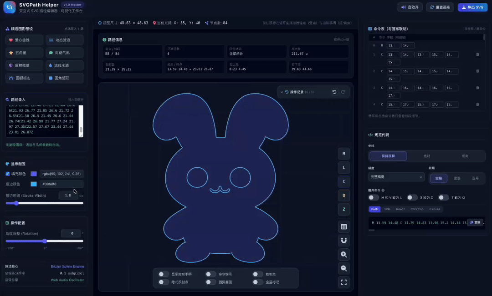

# SVGPath Helper · 交互式 SVG 路径编辑器与可视化工作台

Edit or create SVG paths in browser: https://SVGPathHelper.pipitu.app/
[](https://SVGPathHelper.pipitu.app/)

## 项目简介
**SVGPath Helper** 是一款纯前端交互式 SVG 路径编辑器与可视化工作台。

无需依赖复杂的专业矢量软件，用户可直接在浏览器中通过可视化拖拽控制点、锚点与手柄切线，毫秒级实时生成标准 SVG Path 路径表达式，并自动转译为 **PATH/ SVG / React JSX / CSS Clip-Path / HTML5 Canvas** 等多端工程代码。

---

## 核心功能特性

1. **路径调试与诊断（与画布同源）**
   - 左侧「路径调试与诊断」的 `d` 文本框就是画布的唯一真源：**输入即解析**（防抖），没有「解析检查」「返回编辑」等模式切换。拖拽锚点、编辑命令表参数、追增节点、套预设都会自动回写为 `d` 文本；`⌘/Ctrl + Enter` 与「载入编辑器」可立即把文本应用为可拖拽节点。
   - **字符级语法诊断**：完整实现 SVG 2 路径文法（数字连写 `.5.6` / `10-20` / `1e2`、隐式重复、moveto 后坐标对转隐式 lineto、圆弧标志位连写 `a1 1 0 0110 10`），错误与告警可点击定位到源文本选区；解析失败时与浏览器一致——停在首个错误处，仅渲染之前的有效前缀，且此时不回写文本，不会覆盖尚未改完的原文。
   - **命令表 ↔ 画布联动**（右侧，始终显示）：悬停或点击行即高亮对应线段，并绘制 S/T 的**隐式反射控制点**（绿色菱形）与线段编号；锚点与控制手柄由编辑器绘制，就是可直接拖拽的那一套。反过来，**在画布上点击某条线段**（命中判定按采样点取最近的一段，容差随视野缩放），也会选中它、高亮并自动把对应命令行滚入可见。每行参数是可编辑的数字输入框、行尾有删除按钮：改值或删段都会把路径序列化回写 `d` 文本再全量重解析（起点不可删、删除后至少保留 2 段）。选中某段后（画布点选或命令表钉住/悬停）按 `Delete` 键可用同一出口、同一守卫删除该段（Mac 笔记本的 `fn+Delete`/`Backspace` 同样生效），删除后 ⌘Z 可撤销；焦点在输入框内时该快捷键让位原生文字删除，不做拦截。
   - **圆弧叠加层**：按 F.6.5 由端点参数解出圆心参数，绘制完整椭圆、圆心十字、共轭半径与扫描方向箭头；半径不足、负半径、退化直线等即时告警。
   - **解析式摘要指标**（画布上方、顶部状态栏下方，始终显示）：命令/线段数、子路径数、开闭状态、总长度（8 点 Gauss–Legendre 求积 + 自适应二分）、精确包围盒（曲线极值解析求解，非采样）。
   - **叠加层显示**（画布下方，始终显示）：控制点/隐式反射点/圆弧椭圆/命令编号/全量标记五个叠加开关。载入编辑器后，A 段会按 4/3·tan(Δ/4) 展开成三次贝塞尔（圆弧无法用编辑器的节点模型无损表达）。
   - **视图自适应**：内容能落在 0–600 画布内且不算小时保留原生网格视图；贴入 24×24 图标或使用超大坐标时按包围盒取景，此时坐标轴隐退（它按固定的 0–600 用户坐标绘制，与放大后的取景不再对应），描边粗细、锚点半径、吸附步长与拖拽边界同步按取景比例换算；网格背景是纯屏幕像素，与取景缩放无关，始终跟随「显示辅助网格」开关显示或隐藏。
   - **辅助网格 / 手动缩放与平移**（画布右下角工具列）：首枚图标开关控制辅助网格（开启 `fa-table`，关闭变灰色 `fa-tv` 并压一条斜杠，与原来的「显示辅助网格」复选框同一个开关）；放大 / 缩小以当前视野中心按 10% 步进缩放 viewBox，「适配当前窗口」按内容包围盒重新取景（能落入原生画布时回到默认视图）；在画布上滚动鼠标滚轮（或触控板捏合）即以光标位置为锚点缩放，上滚放大、下滚缩小；也可在画布空白处按住鼠标拖拽平移视图（锚点/控制点上的拖拽仍是移动节点）。缩放与平移只影响观察，不改变路径数据与节点；网格开关只切背景，同样不动路径数据。
   - **在选中段之后追增**（画布右下角工具列 `M` / `L` / `C` / `Q` / `Z` 五枚按钮，参考 insert-after 语义）：先选中一条路径（点击画布线段 / 起点锚点，或命令表行钉住），再点对应按钮，即以**选中段的终点为新段起点**进入待点选状态（光标变十字、一条琥珀色引导虚线跟随鼠标）；在画布空白处点击即把落点作为新段终点生成命令并回写 `d` 源、计入操作记录，可继续拖拽其锚点/控制点微调。`L` 直线、`C` 三次贝塞尔（两个控制点先落在起点）、`Q` 二次贝塞尔、`M` 则从终点新开一段子路径。`Z` 闭合无需落点：点击后直接在选中段之后插入一条 `Z`，笔尖回到所在子路径的起点形成闭合（若选中段为起点 `M` 或已是 `Z` 则提示不重复插入）。未选中任何段时点击按钮会提示「请先选中一条路径」；`Esc` 或再点同一按钮可取消待点选；落点跟随「显示辅助网格」的吸附与当前取景边界。
   - **操作记录与撤销/重做**（画布右上角可伸展面板）：输入路径、载入预设、拖拽节点、命令表编辑等每次都记录，同名相邻操作自动归并为一条（最多 60 条）；面板内可查看时间线、点击任意条目跳转，配套撤销 / 重做按钮与 ⌘Z / ⌘⇧Z（Windows 为 Ctrl+Z / Ctrl+Y）快捷键。

2. **交互式贝塞尔曲线与路径画布**
   - 支持实时绘制并解析 `M (Moveto)`、`L (Lineto)`、`C (三次贝塞尔 Cubic Bézier)`、`Q (二次贝塞尔 Quadratic Bézier)` 与 `Z (Closepath)` 指令。
   - 交互式拖拽锚点（主坐标点）与控制手柄（切线控制点），动态响应式渲染几何路径与曲率。
   - 内置高精度像素网格背景、辅轴与 `Snap-to-Grid` 10px 智能对齐吸附。
   - 填充开关（「渲染外观与描边」卡片）：「填充颜色」复选框控制画布是否按填充色渲染——勾选时形状内部填充、取消时只显示路径描边；它只影响画布预览，不改变导出代码里的 `fill` 值。
   - 描边粗细（同卡片）：上方数字输入框与下方进度条双向联动（0–16 px，步进 0.1，最细可给到 0.1）——拖滑块时数字跟着走，手输越界或非步进值会被吸附到合法档位并回写两处。只改外观，不动路径数据；导出代码里的 `stroke-width` / `strokeWidth` / `lineWidth` 取当前值。
   - **角度调整**（「操作配置」卡片：上方数字输入框，下方 `-180 … 0 … +180` 进度条，两者双向同步）：改变角度即把图形绕**它自己的中心**（含控制点的包围盒中心）旋转，正角顺时针，与 `transform="rotate()"` 同向。这是**数据级**旋转——结果直接烘焙进节点与 `d` 源，导出 SVG / JSX / Canvas / clip-path 全部拿到旋转后的坐标，不是只转视图。拖回起手角度可无损复原；载入预设或编辑 `d` 源等整体重建数据后，控件自动归零。

3. **规范代码生成引擎**
   - **Path**：经过贝塞尔曲线转化的矢量路径代码。
   - **SVG 标准标签**：生成符合 W3C 标准的高保真 `<svg>` 矢量图形代码。
   - **React JSX 组件**：一键生成开箱即用的前端 React 矢量图标组件。
   - **CSS `clip-path`**：生成现代 CSS 路径遮罩样式代码。
   - **HTML5 Canvas 2D**：生成基于 `Path2D` 的原生 JavaScript 渲染脚本。
   - **规范化格式选项**（卡片内，即时生效）：坐标（保持原样/绝对/相对）与间隔（空格/紧凑/逗号）为分段按钮组，精度为暗色风格自定义下拉（默认「完整精度」不取整、有几位小数保留几位，可选 0–6 位，点外部/Esc 收起），展开命令（H 和 V 转为 L、S 转为 C、T 转为 Q）为拨动开关；切换后只重排生成代码与导出 SVG 的路径串，不影响画布与 d 源。「保持原样」（默认）以 d 源为输入，逐段保留作者的大小写与简写命令。

4. **精选矢量预设库**
   - 内置爱心曲线、动态波浪、五角星、对话气泡、盾牌徽章、流线水滴、圆弧标志和圆角矩形等经典矢量形状；位于左侧最上方，点选即把路径写入「路径调试与诊断」的 d 源，由 d 源统一驱动画布、诊断与节点。

5. **Web Audio 过程化微交互音效**
   - 基于原生 Web Audio API，在控制点吸附、节点增删与路径应用时合成清脆的交互音频反馈，提升沉浸式操控感。

---

## 技术架构

- **UI 界面层**：Tailwind CSS 现代化暗黑极客主题 + FontAwesome 6 图标库。
- **矢量计算引擎**：原生 SVG DOM + 贝塞尔曲线几何求值解析器。
- **音效合成**：Web Audio API 原生程序化振荡器（OscillatorNode）。
- **零外部运行时**：纯前端运行，单文件绿色无依赖。

---

## 回归测试

调试器的解析、几何与规范化层不依赖 DOM，可用 Node 直接跑：

```bash
node dbg.test.mjs
```

脚本从 `index.html` 中就地抽取逻辑层执行（117 个断言：文法与诊断、弧长与包围盒精度对照、取景回退与退化极值过滤、手动缩放盒变换（含锚点保持与深缩下限）、角度旋转数学（含恒等往返与退化输入）、规范化输出（含保持原样、完整精度与逐项展开命令），以及 600 例随机路径的「规范化 → 重解析」往返一致性校验）。

开发约定、架构分层与回归点清单见仓库根目录的 [`AGENTS.md`](AGENTS.md)。
